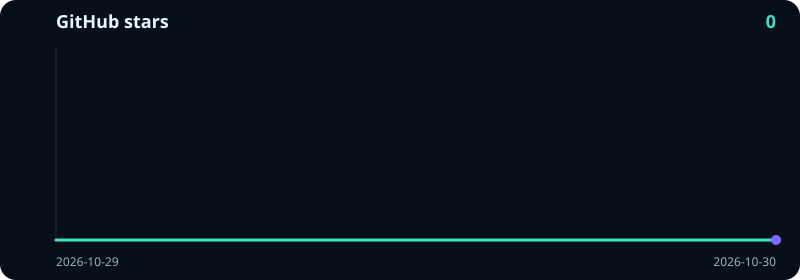

<p align="center">
  
</p>

<h1 align="center">FreeDeepseekAPI</h1>

<p align="center">
  <strong>Local OpenAI-compatible API proxy for DeepSeek Web Chat</strong>
</p>

<p align="center">
  <a href="https://github.com/dekrezz/FreeDeepseekAPI/blob/main/LICENSE"></a>
  
  
  
  
</p>

<p align="center">
  <strong>English</strong> ·
  <a href="README.ru.md">Русский</a> ·
  <a href="README.zh.md">简体中文</a>
</p>

<p align="center">
  <a href="#quick-start">Quick start</a> •
  <a href="#what-you-get">What you get</a> •
  <a href="#request-examples">Examples</a> •
  <a href="#models">Models</a> •
  <a href="#endpoints">Endpoints</a> •
  <a href="#open-webui">Open WebUI</a> •
  <a href="#coding-agents">Coding agents</a>
</p>

<p align="center">
  <a href="#dashboard"></a>
</p>

FreeDeepseekAPI runs a local API server in front of **DeepSeek Web Chat** ([chat.deepseek.com](https://chat.deepseek.com)). Point Open WebUI, LiteLLM, Hermes, Claude Code, Codex, OpenCode, OpenClaw, Cursor, or any OpenAI-compatible client at it.

The project uses your normal logged-in DeepSeek account. The local server accepts API requests, then continues that saved Web session. There is no paid `api.deepseek.com` key.

One model is on the site today: **DeepSeek-V4.1-Flash**. The native Web Search built into chat.deepseek.com is **on by default**, and that search is what answers live internet questions. `-thinking` turns DeepThink on. `-nosearch` or `"web_search": false` turns search off.

> This is an experimental Web-chat proxy. DeepSeek can change its private Web API at any time. When it does, the project is updated to follow, and this guide may change with it. Keep your copy on the newest version: Settings → Updates in the dashboard, or see [Updates](#updates).

---

## Contents

- [Repository layout](#repository-layout)
- [Local changes in this repo](#local-changes-in-this-repo)
- [What you get](#what-you-get)
- [Features](#features)
- [Quick start](#quick-start)
- [Windows](#windows)
- [Linux / Chromium](#linux--chromium)
- [VPS / headless](#vps--headless)
- [Rootless Podman](#rootless-podman)
- [Diagnostics / doctor](#diagnostics--doctor)
- [Session reuse](#session-reuse)
- [Long-term memory](#long-term-memory)
- [Multi-account pool](#multi-account-pool)
- [Dashboard](#dashboard)
- [Updates](#updates)
- [Sign-in](#sign-in)
- [Coding agents](#coding-agents)
- [Check that it works](#check-that-it-works)
- [Request examples](#request-examples)
  - [Chat Completions](#chat-completions)
  - [DeepThink](#deepthink)
  - [Native web search](#native-web-search)
  - [Streaming](#streaming)
  - [Anthropic Messages](#anthropic-messages)
  - [OpenAI Responses](#openai-responses)
  - [Tool calling](#tool-calling)
  - [Images](#images)
- [Models](#models)
- [Endpoints](#endpoints)
- [Environment](#environment)
- [Errors](#errors)
- [Open WebUI](#open-webui)
- [Refresh the login](#refresh-the-login)
- [Tests](#tests)
- [Project status](#project-status)

---

## Repository layout

This repo is one self-contained folder with two parts:

```
<repo root>/
├── server.js            # the proxy itself (port 9655)
├── lib/                 # proxy modules (pow, updater, context compaction)
├── public/, docs/, tests/, scripts/, integrations/
├── local-stack/         # the local launcher that wires everything together
│   ├── Start-All.bat    # start proxy + 9router, then verify
│   ├── Stop-All.bat     # stop both
│   ├── Verify-All.bat   # end-to-end chain check
│   ├── start.ps1 / stop.ps1 / verify.ps1
│   ├── patch-deepseek.ps1, clear-stale-errors.ps1
│   └── README.md, CONTEXT-MEMORY.md, REFACTOR-MODE.md
└── 9router-source/      # optional: 9router source checkout (git-ignored)
```

The proxy is the root of the repo. `local-stack/` is a helper layer: it starts the proxy plus a local 9router instance on port 20128, then proves a request can travel `client → 9router → proxy → DeepSeek`. Scripts in `local-stack/` resolve the proxy as their parent folder, so the repo works wherever you clone it (override with `$env:FREEDEEPSEEK_DIR`).

### Where 9router actually runs from

`local-stack/start.ps1` picks 9router in this order:

| Order | Path | When |
|---|---|---|
| 1 | `$env:NINEROUTER_APP` | you set it explicitly; always wins |
| 2 | `9router-source/cli/app` | a build exists from the checkout in this repo |
| 3 | `%APPDATA%\npm\node_modules\9router\app` | `npm i -g 9router` (fallback) |

The local build wins so that editing `9router-source/` and rebuilding actually takes
effect. If you cloned the repo but never built 9router, the launcher falls through to
the global install and still works. `patch-deepseek.ps1` resolves the target the same
way, so `-Patch` always patches the build that will run.

9router runtime state lives outside both, in `%APPDATA%\9router` (SQLite DB, patch
backups), so upgrading 9router does not touch your accounts or settings.

`9router-source/` is git-ignored, because it is a separate clone with its own history:

```bash
git clone https://github.com/serenhope/9router.git 9router-source
```

### Building 9router from the checkout

`npm run cli:pack` is the official build; it produces `cli/app`, which is the same
layout as the published package. On Windows with Node 24+ two extra steps are needed:

```powershell
cd 9router-source
npm install --ignore-scripts   # better-sqlite3 cannot compile on Node 24+; it is not used
cd cli; npm install --ignore-scripts; cd ..   # provides esbuild for the MITM build step
npm run cli:pack               # -> 9router-source/cli/app  (a few minutes)
```

`--ignore-scripts` is safe here: `src/lib/db/driver.js` skips `better-sqlite3`
entirely on Node 24+ (the native addon SIGSEGVs there) and uses the built-in
`node:sqlite` instead, which needs no compilation.

Then finish the bundle the way `assemble.sh` does on Linux — `build-cli.js` copies only
a handful of `src/` files, but `custom-server.js` loads several modules by absolute path:

```powershell
cd 9router-source
$app = "cli\app"
Remove-Item "$app\src" -Recurse -Force; Copy-Item src "$app\src" -Recurse -Force
Remove-Item "$app\scripts" -Recurse -Force; Copy-Item scripts "$app\scripts" -Recurse -Force
Copy-Item CHANGELOG.md "$app\CHANGELOG.md" -Force
Remove-Item "$app\node_modules\next" -Recurse -Force
Copy-Item node_modules\next "$app\node_modules\next" -Recurse -Force
```

Skipping those four copies gives a build that starts but fails at runtime:
`AuthGuard load failed: ENOENT ...node_modules\next\server.js` (Next.js output tracing
prunes the full `next` package) or a server that silently reads modules out of
`9router-source/src` instead of its own folder.

Finally re-point the new build at the proxy, then restart:

```powershell
local-stack\patch-deepseek.ps1      # auto-detects 9router-source\cli\app
local-stack\Start-All.bat
local-stack\Verify-All.bat          # must end with CHAIN_OK
```

**Rebuild = re-patch.** `patch-deepseek.ps1` rewrites the compiled JS chunks that hold
`https://api.deepseek.com/...`, and a rebuild regenerates those chunks with the
upstream URLs. Always run the patch again after a build, or 9router will talk to
DeepSeek directly instead of through the proxy.


**Quick use on Windows:**

If you install the `deepseek-local` shim (one `.cmd` file, see
[local-stack/README.md](local-stack/README.md#memasang-perintah-deepseek-local)):

```
deepseek-local            start proxy + 9router
deepseek-local off        stop both (alias: stop)
deepseek-local restart    stop, wait for the ports to free, then start
deepseek-local status     is it up, and which 9router build is serving
deepseek-local verify     prove the whole chain end to end
```

Without the shim:

```bat
local-stack\Start-All.bat     :: start everything
local-stack\Verify-All.bat    :: check the whole chain
local-stack\Stop-All.bat      :: stop everything
```

Details: [local-stack/README.md](local-stack/README.md) · context memory: [local-stack/CONTEXT-MEMORY.md](local-stack/CONTEXT-MEMORY.md) · refactor mode: [local-stack/REFACTOR-MODE.md](local-stack/REFACTOR-MODE.md).

> Nothing in this repo ships credentials. `deepseek-auth.json`, `auth.json`, `accounts/*.json`, `data/`, and `local-stack/logs|run` are git-ignored. Log in locally and your own session stays on your machine.

---

## Local changes in this repo

This repository is a fork of [dekrezz/FreeDeepseekAPI](https://github.com/dekrezz/FreeDeepseekAPI) with a set of local changes. The upstream remote is kept as `upstream`, so you can still pull upstream work:

```bash
git fetch upstream
git log --oneline upstream/stable..HEAD    # what is local-only
```

### 1. `local-stack/` — the launcher, merged into this repo

The launcher used to live in a separate folder. It is now a subfolder of the proxy repo, so one clone gives you the whole chain.

| File | What it does |
|---|---|
| `start.ps1` | Starts the proxy and 9router hidden, waits until HTTP is really ready |
| `stop.ps1` | Stops by PID file + command-line pattern, never touches unrelated node processes |
| `verify.ps1` | Checks `/health`, `/v1/models`, and one real completion through 9router |
| `patch-deepseek.ps1` | Idempotent: points the 9router build from `api.deepseek.com` at the proxy |
| `clear-stale-errors.ps1` | Clears stale `401` state and model locks in the 9router SQLite DB |

Two things were fixed while merging:

- **No hardcoded paths.** `start.ps1` resolves the proxy as its parent directory (`..` from `$PSScriptRoot`) and fails loudly if `server.js` is not there. Override with `$env:FREEDEEPSEEK_DIR`. The repo now works wherever you clone it.
- **No hardcoded key.** `verify.ps1` read a real 9router API key from its own source. It now reads `$env:NINEROUTER_KEY`, falling back to `local`, because the proxy accepts any key.

Full launcher documentation: [local-stack/README.md](local-stack/README.md).

### 2. Long-context memory — `lib/context.js`

The proxy used to lose the middle of long sessions and then invent plausible detail to cover the gap. Three causes were fixed:

| Before | Now |
|---|---|
| `storeHistory()` kept only the last 500 characters, cut mid-sentence | Keeps the whole prompt, bounded to 12,000 characters per entry, preserving **both ends** (`boundHistoryText`). History budget is 400,000 characters |
| Tool results were capped at 25% of the budget, then middle turns were `splice`d out silently, oldest first | Opening task kept (capped at 30%), newest ~35% of turns kept verbatim, middle turns **condensed with anchors intact** |
| Whatever was left was cut blindly (`head 25% / tail 75%`) behind a bare `[Earlier context compacted]` marker | `allocateBudget()` water-fills across turns: a short turn takes only what it needs and the rest goes to long turns. Drops happen only if still over, and the count is stated out loud |

The anti-confabulation lever is a notice pinned to every compacted prompt:

```text
[Context notice: this conversation was condensed to fit the model context window.]
- Do not claim to remember details that are not shown above.
- Do not invent file contents, paths, command output, test results, error messages, or earlier statements.
- If a detail you need is missing, say so plainly and re-read the source with a tool instead of guessing.
```

The failure mode was never "the model forgot" — it was "the model did not notice it had forgotten" and filled the hole with confident detail. A model that knows something is missing will re-read the file; a model that does not know will guess.

Replayed history is likewise labelled `[Recovered record of this conversation...]` so a rebuilt session is not mistaken for a verbatim transcript.

Honest limits: this is **not** a real 1M-token window, and compaction is **extractive** (select and cut), not abstractive — no extra LLM call, so no extra cost or latency, but summaries are less clever than true summarization. Anchors are regex-based, so unusual log formats can slip through without anchors.

Details: [local-stack/CONTEXT-MEMORY.md](local-stack/CONTEXT-MEMORY.md).

### 3. Refactor mode — per-request guard-block opt-out

The proxy appends two blocks to the upstream prompt: a `NO-TOOLS CONTRACT` (plain text only, no tool markup) and a `TOOL REMINDER`. One line in the reminder reads **"Do not paste source files or diffs"** — which is exactly the wrong instruction for a refactor request, where the answer *is* the source and a model told not to paste files can only describe the change in prose.

Turning them off globally was the wrong fix: it would weaken every agent request just to serve one refactor call. So the opt-out is **per request**:

| Where | Value |
|---|---|
| JSON body | `"guard_blocks": false` |
| HTTP header | `x-deepseek-guard-blocks: off` (wins over the body) |
| Env fallback | `DEEPSEEK_GUARD_BLOCKS=off` |

Accepted off values: `off`, `0`, `false`, `no`, `none`, `disabled`. Default is on.

What "off" does and does not do:

- It **drops the prohibitions** — no `NO-TOOLS CONTRACT`, and the `TOOL REMINDER` degrades to a bare `TOOL FORMAT` block that states only the wire shape.
- It **keeps the `{"tool_call":...}` envelope** when tools are advertised. That envelope is a parsing contract, not a style rule; removing it turns valid answers into `502 malformed_tool_call`.
- It relaxes the related error paths (`502 no_tools_but_tool_markup` and the `shouldRepairNoTools` repair) so a plain code answer is not treated as a broken tool call.
- Recovery prompts are untouched — they only run after a failure and exist to rescue the request.

**Both settings are needed when going through 9router:**

```json
{ "guard_blocks": false, "tool_choice": "none" }
```

Without `tool_choice: "none"`, the model will pick `write_file` even with the guards off — because the tool is available, not because text was forbidden.

One practical finding: **9router drops client headers**, including `x-deepseek-guard-blocks`. Only body fields survive the hop. Use `guard_blocks` in the body when you call through 9router; the header works on direct proxy calls.

Details and log evidence: [local-stack/REFACTOR-MODE.md](local-stack/REFACTOR-MODE.md).

### 4. Defaults and packaging

| Change | Value |
|---|---|
| `DEEPSEEK_MAX_PROMPT_CHARS` default | `80000` → `800000` (the real Web ceiling, roughly 200k tokens) |
| `Containerfile` | Ships `lib/context.js` alongside `lib/pow.js` and `lib/updater.js` |
| `integrations/cursor/` | Settings snippet and launcher documented; key read from `PROXY_API_KEY` |

`DEEPSEEK_ACCOUNT_COOLDOWN_MS` stays at `600000` (10 minutes), which matches upstream. It is worth knowing why: DeepSeek's own throttle message means "too many messages", and a short cooldown just re-hits the same login while it is still throttled, turning a soft limit into a hard one.

### 5. Repository hygiene

`.gitignore` now also excludes `data/`, `local-stack/logs/`, `local-stack/run/`, `*.bak`, `*.bak-*`, `*.log`, and `Thumbs.db`. Duplicate `.bat` wrappers at the repo root were removed in favour of `local-stack/`, and a stray `server.js.bak-*` backup was deleted.

### Test status

```bash
node --test tests/unit.test.js     # 103 pass
npm test                           # 291 pass, 13 fail
```

The 13 failures are pre-existing and identical to the upstream baseline — they need Chrome, macOS, or tooling not present here. They are not caused by these changes.

---

## What you get

- Use DeepSeek Web as a local API endpoint.
- Connect DeepSeek to Open WebUI and other OpenAI-compatible clients.
- Get a normal JSON body or a streaming SSE response.
- Turn DeepThink on with `-thinking` and read `reasoning_content`.
- Talk to Claude Code through the Anthropic Messages shim.
- Talk to Codex through the OpenAI Responses shim.
- Keep a separate Web chat for each agent or `user` id.
- Let several local tools run in one reply, up to eight.
- Search the live web with DeepSeek's own search, not with bash or a harness websearch tool.

## Features

- **OpenAI-compatible API:** `POST /v1/chat/completions`
- **Anthropic-compatible shim:** `POST /v1/messages`
- **OpenAI Responses shim:** `POST /v1/responses`
- **Streaming:** SSE chunks, and a normal non-stream JSON body
- **DeepThink:** `reasoning_content` when `-thinking` is on
- **Native search:** chat.deepseek.com Web Search, on by default. Off with `-nosearch` or `"web_search": false`
- **Tool calling:** OpenAI tools, Anthropic tools, and Responses function tools, returned as a batch
- **Model capabilities:** `GET /v1/model-capabilities`
- **Agent sessions:** one DeepSeek chat per `x-agent-session` or `user`
- **Session recovery:** an empty reply, a broken tool call, or a timeout keeps the same chat
- **Zero dependencies:** Node.js 18+, no npm packages
- **License:** Apache-2.0

---

## Quick start

```bash
git clone --branch stable https://github.com/dekrezz/FreeDeepseekAPI.git
cd FreeDeepseekAPI
npm run auth
npm start
```

`npm run auth` opens the sign-in menu. Choose Chrome sign-in, log in at chat.deepseek.com in the profile it opens, send a short message such as `ok`, then return to the terminal and continue. The saved file is `deepseek-auth.json`, mode `0600`.

`npm start` opens the launch menu:

- Start proxy
- Start proxy + open dashboard (also `npm run dashboard`)
- Sign in with Chrome
- Import an auth file or a browser cookie export
- Show the DeepSeek-V4.1-Flash model ids
- Quit

Headless or CI, with no menu:

```bash
NON_INTERACTIVE=1 npm start
# or
SKIP_ACCOUNT_MENU=1 npm start
```

The server listens on:

```text
http://127.0.0.1:9655
```

By default only this computer can reach it. To publish it on a network, set an address and a proxy key:

```bash
HOST=0.0.0.0 PROXY_API_KEY='replace-with-a-long-random-value' npm start
```

Send that key as `Authorization: Bearer <key>`. Without `PROXY_API_KEY`, the API has no authentication of its own. Do not put that instance on a network.

Browser calls are allowed from loopback origins. If the UI is on another origin, list the exact origins, comma-separated:

```bash
PROXY_CORS_ORIGINS='https://ui.example.com,http://192.168.1.20:3000'
```

---

## Windows

```powershell
git clone --branch stable https://github.com/dekrezz/FreeDeepseekAPI.git
cd FreeDeepseekAPI
npm run auth
npm start
```

If Chrome is not in the usual place:

```powershell
$env:CHROME_PATH="C:\Program Files\Google\Chrome\Application\chrome.exe"
npm run auth
```

When Chrome is missing, `npm run auth` prints the install path for Windows, macOS, or Linux instead of a raw stack trace.

---

## Linux / Chromium

```bash
git clone --branch stable https://github.com/dekrezz/FreeDeepseekAPI.git
cd FreeDeepseekAPI
CHROME_PATH=$(which chromium) npm run auth
npm start
```

If the binary has another name:

```bash
CHROME_PATH=$(which chromium-browser) npm run auth
# or
CHROME_PATH=$(which google-chrome) npm run auth
```

---

## VPS / headless

The reliable path does not run Chrome on the server.

1. On a machine that has a GUI and Chrome:

```bash
npm run auth
```

2. Copy `deepseek-auth.json` to the VPS:

```bash
scp deepseek-auth.json user@your-vps:/opt/FreeDeepseekAPI/deepseek-auth.json
```

3. Import it and check the file:

```bash
cd /opt/FreeDeepseekAPI
npm run auth:import -- --input ./deepseek-auth.json
npm run doctor -- --offline
```

4. Start the proxy with no menu:

```bash
NON_INTERACTIVE=1 npm start
```

A browser cookie export works too, if you also have the token:

```bash
DEEPSEEK_TOKEN="<token>" npm run auth:import -- --input ./cookies.json
```

`deepseek-auth.json` is access to your DeepSeek Web login. Do not commit it, do not paste it into a chat, and keep it mode `0600`.

There is no password login command. The proxy never asks for your DeepSeek password and never stores one. Sign-in is Chrome, a saved auth file, or a cookie export plus token.

---

## Rootless Podman

The container only runs the proxy. Sign in on the host with `npm run auth`. Auth scripts and `deepseek-auth.json` are not copied into the image.

Run Podman as your user, not as root.

1. Build the image:

```bash
podman build --tag localhost/free-deepseek-api:local --file Containerfile .
```

2. Store the DeepSeek auth file and a separate proxy key as secrets:

```bash
podman secret create --replace free-deepseek-auth ./deepseek-auth.json

printf 'Proxy API key: '
IFS= read -r -s PROXY_API_KEY
printf '\n'
printf '%s' "$PROXY_API_KEY" |
  podman secret create --replace free-deepseek-proxy-key -
```

Use a long random key. The value stays in this shell so you can call the API. It is not baked into the image or the Podman command line.

3. Start the container with the privileges dropped:

```bash
podman run --detach \
  --name free-deepseek-api \
  --publish 127.0.0.1:9655:9655 \
  --secret free-deepseek-auth,type=mount,target=/run/secrets/deepseek-auth.json,mode=0400 \
  --secret free-deepseek-proxy-key,type=mount,target=/run/secrets/proxy-api-key,mode=0400 \
  --read-only \
  --cap-drop=ALL \
  --security-opt=no-new-privileges \
  localhost/free-deepseek-api:local
```

Inside the image, `NON_INTERACTIVE=1`, `HOST=0.0.0.0`, and `REQUIRE_PROXY_API_KEY=1` are already set. The container refuses to serve if the proxy-key secret is missing or empty. On the host the port is published only on `127.0.0.1`. Do not drop that address unless you have a firewall in front of it.

4. Check liveness, account readiness, and the protected model list:

```bash
podman healthcheck run free-deepseek-api
curl --fail http://127.0.0.1:9655/readyz
curl --fail \
  -H "Authorization: Bearer $PROXY_API_KEY" \
  http://127.0.0.1:9655/v1/models
```

The built-in healthcheck hits local `/health` and only tells you the process is up. `/readyz` returns `503` when no DeepSeek login can serve a chat right now.

```bash
podman logs free-deepseek-api
podman inspect --format '{{.State.Health.Status}}' free-deepseek-api
```

Stop the container and remove the secrets:

```bash
podman stop free-deepseek-api
podman rm free-deepseek-api
podman secret rm free-deepseek-auth free-deepseek-proxy-key
unset PROXY_API_KEY
```

When you rotate the login or the proxy key, replace the secret and recreate the container.

---

## Diagnostics / doctor

```bash
npm run doctor
# no network call to DeepSeek:
npm run doctor -- --offline
```

`doctor` checks:

- whether `deepseek-auth.json` or `DEEPSEEK_AUTH_DIR` is present;
- whether the JSON parses;
- whether `token`, `cookie`, and `wasmUrl` are set;
- whether the file mode is `0600` on macOS and Linux;
- on a normal run, whether the DeepSeek PoW endpoint answers.

If you see `data.biz_data is null`, `fetch failed`, `401`, `403`, `429`, or a coding agent that cannot list models, run `npm run doctor` first.

---

## Session reuse

FreeDeepseekAPI does not open a new DeepSeek chat on every HTTP request.

- One `x-agent-session`, `session`, or `user` value is one DeepSeek chat.
- When that chat already exists, the proxy continues it with `parent_message_id`.
- The standing system prompt and the tool list go upstream **once**. Later turns from OpenCode, Claude Code, and Codex send only the new user or tool turn.
- A changed system prompt is sent again.
- An empty reply, a broken tool-call, or a timeout **keeps** the live chat. Those failures used to open a new chat and resend the whole prompt. They do not anymore.
- A new chat starts when the session is missing, the chain hits `DEEPSEEK_MAX_MESSAGE_DEPTH`, the chat is older than `DEEPSEEK_SESSION_TTL_MS`, DeepSeek says the prompt is too long, or you call `/reset-session`.
- Long prompts are cut to `DEEPSEEK_MAX_PROMPT_CHARS` (default 800,000 characters) before they are sent. The start of the task, the latest tool results, and the tool reminder stay. Compaction is structured, not a blind head/tail cut: see [Long-context memory](#2-long-context-memory--libcontextjs).
- If the client already sent a multi-turn history, the proxy does not paste its own recovery history a second time.
- When the replayed recovery history alone would overflow that cap, it is condensed to about a third of the budget rather than dropped. Losing it entirely used to leave a long session with no memory at all, right when recovery mattered.
- An empty reply is retried up to `DEEPSEEK_MAX_RETRIES` times (default 2). Each retry uses a smaller slice of context, still on the same chat when that chat is alive.

Set the agent explicitly:

```bash
curl -X POST http://127.0.0.1:9655/v1/chat/completions \
  -H "Content-Type: application/json" \
  -H "x-agent-session: my-agent" \
  -d '{"model":"deepseek-v4-flash","messages":[{"role":"user","content":"Hello"}]}'
```

List active sessions:

```bash
curl http://127.0.0.1:9655/v1/sessions
```

Reset one session:

```bash
curl -X POST "http://127.0.0.1:9655/reset-session?agent=my-agent"
```

Reset every session:

```bash
curl -X POST "http://127.0.0.1:9655/reset-session?agent=all"
```

A reset keeps the proxy's copy of the conversation and replays it into the next chat when the client sends only one message. Add `&history=drop` when the client will send its own full transcript, for example after editing an earlier message, so the replaced turns do not come back.

You will still see chats in the DeepSeek website. The proxy uses the Web Chat API, and DeepSeek stores the real chats. Session reuse only stops the proxy from opening a new one when the current chain is still good.

A message whose text is exactly `/new` resets that agent's remote chat instead of sending the text to the model.

### Session lifetime and its limits

A session is a *working* memory, not a permanent one. Both limits are configurable now, but neither removes the ceiling:

| Limit | Default | Env var |
|---|---|---|
| Chat reused for | 2 hours | `DEEPSEEK_SESSION_TTL_MS` |
| Messages per chat | 100 | `DEEPSEEK_MAX_MESSAGE_DEPTH` |
| History replayed into a replacement chat | 100 messages | `DEEPSEEK_MAX_HISTORY_MESSAGES` |
| History replay budget | 400000 chars | `DEEPSEEK_MAX_HISTORY_CHARS` |
| Idle session kept on disk | 2 × TTL | `DEEPSEEK_SESSION_IDLE_EVICT_MS` |
| Sessions loaded at startup | 500 | `DEEPSEEK_MAX_SESSIONS` |

```bash
# A deliberately long coding session: 24 hours, 500 messages.
DEEPSEEK_SESSION_TTL_MS=86400000 DEEPSEEK_MAX_MESSAGE_DEPTH=500 \
  DEEPSEEK_MAX_HISTORY_MESSAGES=500 npm start
```

The two replay caps move with `DEEPSEEK_MAX_MESSAGE_DEPTH`, not independently. When a chat is replaced the proxy re-injects its local transcript; if the replay depth stayed at 100, a "500-message" session would still recover only the last 100 turns. Raise them together.

Keep `DEEPSEEK_MAX_HISTORY_CHARS` at or below `DEEPSEEK_MAX_PROMPT_CHARS`. Anything above the prompt cap cannot be sent anyway, so it only decides how much gets condensed away: the replay is capped at about a third of the prompt budget and the rest is summarised by `lib/context.js`.

`GET /health` reports the effective values under `session_reuse`, so you can confirm an override took effect without reading the source.

Raising these helps a long task survive. It does not create long-term memory: the session is still scoped to one agent key and still expires eventually. For facts that must outlive the session, use the system prompt — see below.

---

## Long-term memory

The proxy has **no** long-term memory, and that is by design. It is a transport layer: it forwards a conversation and replays a bounded local history when the remote chat dies. It does not decide what is worth remembering.

Long-term memory comes from the **system prompt**, because the system prompt is re-sent on every request regardless of session. Anything you put there is known to every future session.

| Layer | Holds | Lifetime |
|---|---|---|
| Session store | Today's conversation | 2 hours (configurable) |
| System prompt / `AGENTS.md` | Standing rules: style, conventions, prohibitions | Until you edit the file |
| `MEMORY.md` per project | Durable facts: ports, commands, decisions, traps | Until you edit the file |

### Verified behaviour

Two brand-new sessions with no shared history, given the same system-prompt memo, both knew the fact. The same question with no memo returned `UNKNOWN`:

```
fresh session A  -> KUNING-MERAK-55
fresh session B  -> KUNING-MERAK-55
no system prompt -> UNKNOWN
```

A memo of 2,000, 20,000, and 80,000 characters was recalled accurately with the fact placed at the very end — the hardest position. Treat ~80,000 characters as the practical ceiling for a memo that must be remembered precisely; beyond that, compaction starts cutting.

### Setting it up

OpenCode already reads `~/.config/opencode/AGENTS.md` on every session. Add the memory rules there (a `durable-memory` section is included in this setup) and keep a `MEMORY.md` in each project root:

```markdown
# Project Acme Billing

## Facts
- DB: Postgres 16, port 5433 (not the default)
- Deploy staging: ./scripts/deploy.sh staging

## Commands
- Tests: `npm run test:unit` — never `npm test`, that also runs browser tests

## Decisions
- 2026-10-29 — Chose 9router for multi-provider routing; revisit only if we drop
  the second provider.

## Traps
- Running `npm run seed` twice duplicates rows. Truncate first.
```

A starter template lives at `~/.config/opencode/MEMORY.template.md`.

### The honest limitation

Nothing here is automatic. The model does not remember and then save; either you write to the file, or you instruct the agent to write to it. The rule that makes it work is in `AGENTS.md`: *read `MEMORY.md` before your first change, append when you learn something durable*.

Memory is the file, not the model.

---

## Multi-account pool

DeepSeek can ban a login for days if two chats send on that same login at the same time. The pool rule is: one in-flight chat per login. A second request for a busy login waits. It does not overlap.

Sticky means the proxy does not hop accounts in the middle of a live chat, except when that login is rate-limited or loses auth. If the login gets `401` or `403`, or DeepSeek rate-limits it, the login goes into cooldown and the old remote session is dropped. A rate-limited request does not fail: it moves right away to another ready login, on a new chat that gets the full transcript. After `401`/`403`, the next request moves.

Directory of auth files:

```bash
mkdir -p accounts
npm run auth:import -- --input ~/Downloads/deepseek-auth.json --output ./accounts/worker-2.json
chmod 600 accounts/*.json deepseek-auth.json
DEEPSEEK_AUTH_DIR=./accounts NON_INTERACTIVE=1 npm start
```

Or a comma-separated list:

```bash
DEEPSEEK_AUTH_PATH="./accounts/main.json,./accounts/backup.json" NON_INTERACTIVE=1 npm start
```

How the pool behaves:

- a new agent gets a free login, round-robin;
- that login stays stuck to the session;
- `401`, `403`, and rate limits put the login in cooldown (`DEEPSEEK_ACCOUNT_COOLDOWN_MS`, default 10 minutes). A rate limit is HTTP `429`, a "too frequent" message in an HTTP `400` or JSON body (for example `Слишком частые сообщения`), or a DeepSeek stream hint with `finish_reason: rate_limit_reached`. `Retry-After` is honored when DeepSeek sends it;
- the rate-limited request moves to another ready login on a new chat. Only when every login is cooling down does the client get `429 rate_limit`;
- other `400` errors do not cause a cooldown. The chat is recreated on the same login;
- two requests and two free logins go to different accounts;
- the same `x-agent-session` overlapping waits on its login (`DEEPSEEK_ACCOUNT_LOCK_WAIT_MS`, default 120 seconds);
- when every login is busy, the request waits on the sticky or least-recently-used login;
- OpenCode's session-title request is answered locally and does not occupy a login;
- `/health` shows account status without auth-file paths or file names;
- `/dashboard` shows every login and lets you pause, resume, clear a cooldown, and reload auth files without a restart (see [Dashboard](#dashboard));
- auth files must be mode `0600`.

You cannot pin a client to a chosen file. The proxy picks a free login.

```bash
DEEPSEEK_ACCOUNT_COOLDOWN_MS=600000 npm start
```

---

## Dashboard

Open `http://127.0.0.1:9655/dashboard`. It lists every login with its state (`ready`, `busy`, `cooldown`, `disabled`, `no_credentials`), the cooldown countdown and reason, consecutive and total failures, the last upstream error, and usage. From there you can:

- **Disable / Enable** a login. This is a runtime pause: in-flight work finishes, and a restart forgets it. `"enabled": false` in the auth file is the persistent switch; a login disabled in its file cannot be enabled from the dashboard.
- **Clear cooldown** to put a cooling login back in rotation now.
- **Reload accounts** to re-read the auth files. New files are added and deleted files are removed. A kept login keeps its cooldown and counters. A login whose token or cookie changed starts fresh.

To add a login, import it and press Reload:

```bash
npm run auth:import -- --input ~/Downloads/deepseek-auth.json --output ./accounts/worker-3.json
```

The page is static and holds no data. It reads the admin API:

| Method | Path | Result |
|---|---|---|
| `GET` | `/admin/accounts` | `{ now, pool, accounts }` |
| `POST` | `/admin/accounts/<id>/disable` | `{ account, pool }` |
| `POST` | `/admin/accounts/<id>/enable` | `{ account, pool }`. `409 disabled_in_file` if the file says `"enabled": false` |
| `POST` | `/admin/accounts/<id>/clear-cooldown` | `{ account, pool }` |
| `POST` | `/admin/accounts/reload` | `{ added, removed, kept, errors, accounts, pool }`. `422 no_accounts_found` leaves the pool unchanged |
| `POST` | `/admin/accounts/restore` | Body `{ archived_as }` from a `DELETE`. Renames the file back and reloads: `{ restored, errors, accounts, pool }`. `404 archive_not_found`, `409 restore_target_exists` |

Access rules:

- With `PROXY_API_KEY` set, `/admin/*` needs the same bearer as `/v1/*`. The page asks for the key and keeps it in the tab's session storage only.
- Without a key, `/admin/*` answers only direct loopback clients. A request that carries `X-Forwarded-For`, `Forwarded`, or `X-Real-IP` is refused with `403 admin_forbidden`, even from `127.0.0.1`. So is a non-localhost `Host`, or a browser `Origin` other than the proxy's own (another local web app cannot pause logins). `PROXY_ADMIN_ALLOW_REMOTE=1` lifts only the client address rule. The `Host` must still be loopback, an IP address, or a host listed in `PROXY_CORS_ORIGINS`, and a browser `Origin` must still be the proxy's own. Anyone who can reach the port can still pause logins, so prefer a key on a network bind.
- Browser POSTs still pass the origin guard. To use the dashboard from a non-loopback address, add that origin to `PROXY_CORS_ORIGINS`.
- Admin responses never contain tokens, cookies, `hif_*` values, or auth-file names.

The container image ships the dashboard. With `--read-only`, actions that write auth files (add, rename, remove, restore) fail with `500 auth_file_write_failed`; pause, resume, and clear cooldown work.

---

## Updates

DeepSeek changes its Web chat from time to time, and FreeDeepseekAPI follows. Keep your copy current.

Two channels, both branches on GitHub:

| Channel | What it gets |
|---|---|
| `stable` | A release once it has been checked. The default, and what Quick start clones. |
| `latest` | Every release as soon as it is out. |

**From the dashboard:** Settings → Updates. Pick a channel, **Check for updates** shows what is new, **Install** moves your copy to it, **Restart now** loads it. The restart is automatic when the proxy runs with `npm start` or `npm run dashboard`; otherwise stop it and start it again.

The dashboard only moves your copy forward. It stops and shows the command to run by hand when the folder has uncommitted changes to tracked files or your channel branch has commits of its own. A container image or a downloaded archive has no git history: pull a new image or download the new release.

**By hand:**

```bash
git fetch origin && git switch stable && git merge --ff-only origin/stable
```

Then restart the proxy.

---

## Sign-in

| Command | What it does |
|---|---|
| `npm run auth` | Menu: Chrome sign-in, import, status, delete the local file |
| `npm run deepseek:auth` | Chrome capture of token and cookies |
| `npm run auth:import` | Import `deepseek-auth.json` or a browser cookie export |
| `npm run doctor` | Check the files. Drop `--offline` to also hit PoW |

Chrome extension: load `chrome-extension/` on an open chat.deepseek.com tab. Collect until **Token** is Ready, then save the file. Do not paste that JSON into a chat.

Fields: `token`, `cookie`, `wasmUrl` (an `https://*.deepseek.com` address). Optional: `hif_dliq`, `hif_leim`, `name`, and `enabled` (`false` pauses that login). See [`auth.example.json`](auth.example.json).

The password of the DeepSeek account is not an input. There is no `auth:console` command, and none should store a password on disk.

---

## Coding agents

```bash
npm run setup:agents
npm run setup:agents -- --all --model deepseek-v4-flash
npm run setup:agents -- --target claude-code --model deepseek-v4-flash-thinking
npm run setup:agents -- --target codex --model deepseek-v4-flash
```

The proxy must already be listening. The default origin is `http://127.0.0.1:9655`. Override it with `--base-url`. If `PROXY_API_KEY` is set, it is copied into the agent config.

Setup adds FreeDeepseekAPI as an opt-in profile. It does not replace Claude, GPT, or whatever you already use.

| Agent | What is written | How you select it |
|---|---|---|
| Claude Code | `~/.claude/freedeepseek.settings.json` | `claude --settings ~/.claude/freedeepseek.settings.json` |
| Codex | `~/.codex/freedeepseek.config.toml` and a model catalog | `codex --profile freedeepseek` |
| OpenCode | a `freedeepseek` provider, plus autonomy rules in `AGENTS.md` | pick `freedeepseek/<id>` |
| Hermes | `~/.hermes/freedeepseek.yaml` | that profile file |
| OpenClaw | a `freedeepseek` provider | pick it explicitly |
| Cursor | a snippet and launcher under `integrations/cursor/` | editor settings stay as they are |

`--model` is always DeepSeek-V4.1-Flash, with native chat.deepseek.com search on. `-thinking` turns DeepThink on. `-nosearch` turns search off; the agent then keeps its own web tools. An old `-search` id maps to the same id without the suffix.

Codex setup does **not** set `forced_login_method = api`. On Codex CLI that line logs you out of ChatGPT. Normal `codex` stays on ChatGPT. The FreeDeepseek profile talks to this proxy.

Images:

- Claude Code: paste or attach. The Anthropic `image` block is uploaded to DeepSeek Web.
- Codex: `codex -i screenshot.png`. Repeat `-i` for more files. `/v1/responses` accepts `input_image`.
- OpenCode: paste or drop an image. The generated config keeps attachments.
- Other OpenAI clients: send `image_url` as a base64 data URL or a public HTTPS URL.

Restore a previous setup from its backup:

```bash
node scripts/setup-agents.js --restore ~/.freedeepseek-api/backups/<stamp>
```

Two agents at once need two Web logins in `accounts/`. Details: [docs/agents.md](docs/agents.md).

---

## Check that it works

```bash
curl http://127.0.0.1:9655/health
curl http://127.0.0.1:9655/readyz
curl http://127.0.0.1:9655/v1/models
curl http://127.0.0.1:9655/v1/model-capabilities
```

`/health` is liveness. `/readyz` is `200` only when at least one login can serve. `/v1/models` lists the four DeepSeek-V4.1-Flash ids.

---

## Request examples

### Chat Completions

```bash
curl -X POST http://127.0.0.1:9655/v1/chat/completions \
  -H "Content-Type: application/json" \
  -H "x-agent-session: my-agent" \
  -d '{
    "model": "deepseek-v4-flash",
    "messages": [{"role": "user", "content": "Answer in one sentence."}],
    "stream": false
  }'
```

### DeepThink

`-thinking` is the DeepThink switch from the chat composer. The model is still DeepSeek-V4.1-Flash. It reasons before the answer.

```bash
curl -X POST http://127.0.0.1:9655/v1/chat/completions \
  -H "Content-Type: application/json" \
  -d '{
    "model": "deepseek-v4-flash-thinking",
    "messages": [{"role": "user", "content": "Why is the sky blue? Keep it short."}],
    "stream": false
  }'
```

Where the reasoning shows up:

- non-stream: `choices[0].message.reasoning_content`
- stream: `choices[0].delta.reasoning_content`
- usage: `usage.completion_tokens_details.reasoning_tokens`

`reasoning_tokens` is an estimate from the extracted DeepThink text. The Web stream does not report official reasoning-token usage.

A tool-call turn does not attach reasoning to the message. Some agents treat any text next to a tool call as the final answer and stop.

### Native web search

The native Web Search of chat.deepseek.com is on by default, for every model id. Internet questions go through that search. Do not ask the model to use bash, curl, or a harness `websearch` / `webfetch` tool for the live web.

```bash
curl -X POST http://127.0.0.1:9655/v1/chat/completions \
  -H "Content-Type: application/json" \
  -d '{
    "model": "deepseek-v4-flash",
    "messages": [{"role": "user", "content": "Find a current fact about DeepSeek and answer briefly."}],
    "stream": false
  }'
```

To answer without search, send `"web_search": false`, or use an id ending in `-nosearch`:

```bash
curl -X POST http://127.0.0.1:9655/v1/chat/completions \
  -H "Content-Type: application/json" \
  -d '{
    "model": "deepseek-v4-flash-thinking",
    "web_search": false,
    "messages": [{"role": "user", "content": "Explain how a B-tree splits a node."}],
    "stream": false
  }'
```

`web_search` must be `true` or `false`; any other value returns `400 invalid_request_error`. It overrides the id: `"web_search": true` on a `-nosearch` id turns search back on. The field works on `/v1/chat/completions`, `/v1/messages`, and `/v1/responses`.

With search off, a coding agent keeps its own `websearch` / `webfetch` tools and is not told that native search is on.

### Streaming

```bash
curl -N -X POST http://127.0.0.1:9655/v1/chat/completions \
  -H "Content-Type: application/json" \
  -d '{
    "model": "deepseek-v4-flash",
    "messages": [{"role": "user", "content": "Tell a short joke."}],
    "stream": true
  }'
```

The last SSE chunk carries `usage`, then `data: [DONE]`.

### Anthropic Messages

```bash
curl -X POST http://127.0.0.1:9655/v1/messages \
  -H "Content-Type: application/json" \
  -d '{
    "model": "deepseek-v4-flash",
    "max_tokens": 512,
    "messages": [{"role": "user", "content": "Reply with exactly OK"}],
    "stream": false
  }'
```

Claude Code, after `npm run setup:agents -- --target claude-code`:

```bash
claude --settings ~/.claude/freedeepseek.settings.json
```

Names such as `claude-sonnet-*` and `claude-opus-*` are mapped onto DeepSeek-V4.1-Flash and DeepSeek-V4.1-Flash with DeepThink, so a leftover Claude id still runs.

### OpenAI Responses

```bash
curl -X POST http://127.0.0.1:9655/v1/responses \
  -H "Content-Type: application/json" \
  -d '{
    "model": "deepseek-v4-flash",
    "input": "Reply with exactly OK",
    "stream": false
  }'
```

Codex uses this route. After setup:

```bash
codex --profile freedeepseek
```

### Tool calling

The proxy accepts OpenAI `tools`, Anthropic `tools`, and Responses function tools.

DeepSeek Web has no native tool-call array. The proxy writes the tool list into the prompt and parses the reply back into OpenAI `tool_calls`. Accepted shapes:

- `{"tool_call":{"name":"...","arguments":{...}}}`
- `{"tool_calls":[{"name":"...","arguments":{...}}]}` — several independent calls, up to 8
- `TOOL_CALL:` plus a JSON object
- a fenced JSON envelope with `tool_call`, `tool_calls`, or `function_call`
- `<tool_call>...</tool_call>`
- DeepSeek DSML, including the doubled-bar Web variant

`execute_code` and `web_search` are DeepSeek's own tools. They are not run on your computer. If they appear next to a real local tool such as `read_file`, they are dropped and the local calls are kept. A half-written tool block is not executed. One repair retry asks for strict JSON. If that is still broken, the turn returns `502 malformed_tool_call` and the chat stays open.

While native search is on, harness `websearch`, `webfetch`, and `WebFetch` tools are stripped and the live web is the native chat.deepseek.com search. With search off they reach the agent unchanged.

#### Guard blocks, and when to turn them off

Two prompt blocks ride along with tool requests: a `NO-TOOLS CONTRACT` and a `TOOL REMINDER`. They keep agents calling tools instead of describing what they would do — good for agent traffic, actively wrong for a request whose answer is source code.

The opt-out is per request, so one refactor call does not weaken everything else:

```bash
# direct to the proxy: header works
curl -X POST http://127.0.0.1:9655/v1/chat/completions \
  -H "Content-Type: application/json" \
  -H "x-deepseek-guard-blocks: off" \
  -d '{"model":"deepseek-v4-flash","tool_choice":"none", ...}'
```

```json
// through 9router: 9router strips client headers, so use the body field
{ "model": "ds/deepseek-v4-flash", "guard_blocks": false, "tool_choice": "none" }
```

Default is on. `DEEPSEEK_GUARD_BLOCKS=off` disables it process-wide, which is rarely what you want. What stays even when it is off: the `{"tool_call":...}` envelope when tools are advertised — that is the parsing contract, and removing it produces `502 malformed_tool_call`. See [Refactor mode](#3-refactor-mode--per-request-guard-block-opt-out).

### Images

PNG, JPEG, WebP, and GIF. Up to 10 images, 20 MiB decoded each. The JSON body defaults to 30 MiB.

The proxy uploads the image to DeepSeek Web, waits until parsing finishes, then sends the file id. A provider `file_id` is rejected. A URL must be public HTTPS. Redirects into local, private, or link-local addresses are rejected.

OpenAI Chat Completions uses `image_url`. Responses uses `input_image`. Anthropic uses an `image` block with base64. See [docs/api.md](docs/api.md).

---

## Models

`GET /v1/models` lists only DeepSeek-V4.1-Flash.

| ID | DeepThink | Native web search | What it does |
|---|---|---|---|
| `deepseek-v4-flash` | off | on | DeepSeek-V4.1-Flash. `deepseek-flash` is the same id |
| `deepseek-v4-flash-thinking` | on | on | DeepThink, then the answer |
| `deepseek-v4-flash-nosearch` | off | off | No native search |
| `deepseek-v4-flash-thinking-nosearch` | on | off | DeepThink without native search |

These suffixes are the two switches in the DeepSeek chat composer. They do not select another model. `"web_search": true|false` in the request body overrides the search switch of any id.

The old `deepseek-v4-flash-search` and `deepseek-v4-flash-thinking-search` ids still work. They mean `deepseek-v4-flash` and `deepseek-v4-flash-thinking` and are no longer listed in `/v1/models`.

Older ids are not registered and return `400 invalid_model`:

`deepseek-chat`, `deepseek-reasoner`, `deepseek-r1`, `deepseek-v3`, `deepseek-instant`, `deepseek-expert`, `deepseek-v4-pro`, `deepseek-chat-search`, and vision.

```bash
curl http://127.0.0.1:9655/v1/model-capabilities
```

Full table: [docs/models.md](docs/models.md).

---

## Endpoints

| Method | Path | Purpose |
|---|---|---|
| `GET` | `/health` | Process is up. Account status if no proxy key, or the bearer matches |
| `GET` | `/readyz` | `200` only if a login can serve now |
| `GET` | `/dashboard` | Account dashboard (static page) |
| `GET` | `/admin/accounts` | Pool and per-login status. See [Dashboard](#dashboard) |
| `POST` | `/admin/accounts/<id>/{disable,enable,clear-cooldown}` | Pause, resume, or un-cool one login |
| `POST` | `/admin/accounts/reload` | Re-read auth files without a restart |
| `GET` | `/v1/models` | The four DeepSeek-V4.1-Flash ids |
| `GET` | `/v1/model-capabilities` | Ids, DeepThink, and native search |
| `POST` | `/v1/chat/completions` | OpenAI Chat Completions |
| `POST` | `/v1/messages` | Anthropic Messages |
| `POST` | `/v1/responses` | OpenAI Responses |
| `GET` | `/v1/sessions` | Local agent sessions |
| `POST` | `/reset-session?agent=<id>` | Drop one Web chat |
| `POST` | `/reset-session?agent=all` | Drop every Web chat |

---

## Environment

| Variable | Default | Meaning |
|---|---|---|
| `HOST` | `127.0.0.1` | Bind address. A non-loopback bind without a proxy key prints a warning |
| `PORT` | `9655` | Listen port |
| `PROXY_API_KEY` | off | Bearer required on `/v1/*` and `/admin/*` when set |
| `REQUIRE_PROXY_API_KEY` | off | Refuse to start if the key is missing. The container sets this |
| `PROXY_CORS_ORIGINS` | loopback | Extra exact browser origins |
| `PROXY_ADMIN_ALLOW_REMOTE` | off | If `1`, `/admin/*` answers non-loopback clients even without `PROXY_API_KEY` |
| `DEEPSEEK_AUTH_PATH` | `./deepseek-auth.json` | One file, or a comma-separated list |
| `DEEPSEEK_AUTH_DIR` | `./accounts` when that directory exists | Every `*.json` in it |
| `DEEPSEEK_MAX_PROMPT_CHARS` | `800000` | Cap on what is sent upstream. Minimum 16000 |
| `DEEPSEEK_MAX_RETRIES` | `2` | Empty-reply retries on the same chat |
| `DEEPSEEK_REQUEST_DEADLINE_MS` | `120000` | Per-request deadline |
| `DEEPSEEK_MAX_CONCURRENT` | `24` | Process-wide cap. Real parallelism is the number of idle logins |
| `DEEPSEEK_ACCOUNT_LOCK_WAIT_MS` | `120000` | How long a second chat waits for a busy login |
| `DEEPSEEK_ACCOUNT_COOLDOWN_MS` | `600000` | Base cooldown after 401, 403, or a rate limit without `Retry-After`. DeepSeek throttles a browser session with "Слишком частые сообщения" — no header, so proxy defaults to 10 minutes. Lower at own risk. Without a `Retry-After`, the window escalates ×2 (up to ×4) each time the login is re-throttled right after its previous window expired; a successful request resets the ladder. |
| `DEEPSEEK_AUTH_EXPIRED_COOLDOWN_MS` | `1800000` | Quarantine for a login whose credential DeepSeek rejects twice in a row as invalid (business code 40001–40003). A dead token does not recover by waiting; a re-login (new token/cookie file) clears it because the credential fingerprint changes. |
| `DEEPSEEK_COOLDOWN_STATE_PATH` | `./data/cooldowns.json` | Where per-account cooldowns are persisted. A restart restores the cooldown so you cannot "restart your way out" of a throttle. Set empty to disable. |
| `DEEPSEEK_GUARD_BLOCKS` | on | Fallback for the prompt guard blocks. `off` disables them process-wide; prefer the per-request `guard_blocks` body field. See [Refactor mode](#3-refactor-mode--per-request-guard-block-opt-out) |
| `DEEPSEEK_SESSION_TTL_MS` | `7200000` | How long one DeepSeek chat is reused before the proxy opens a fresh one and replays local history. Default 2 hours. See [Session lifetime](#session-lifetime-and-its-limits) |
| `DEEPSEEK_MAX_MESSAGE_DEPTH` | `100` | Messages per chat before a forced reset. Minimum 2 |
| `DEEPSEEK_MAX_HISTORY_MESSAGES` | `100` | Local turns replayed into a replacement chat. Raise it with `DEEPSEEK_MAX_MESSAGE_DEPTH` or a deep session recovers only the last 100 turns. Minimum 2 |
| `DEEPSEEK_MAX_HISTORY_CHARS` | `400000` | Char budget for that replay. One huge paste cannot evict everything else: per-entry caps apply too. Minimum 1000 |
| `DEEPSEEK_SESSION_IDLE_EVICT_MS` | `2 × TTL` | How long an idle session survives on disk across restarts |
| `DEEPSEEK_MAX_SESSIONS` | `500` | Session cap loaded from disk at startup |
| `TRUST_PROXY` | off | If `1`, the client IP is taken from `X-Forwarded-For` |
| `MAX_REQUEST_BODY_BYTES` | `31457280` | Maximum JSON body, including base64 images |
| `NON_INTERACTIVE` / `SKIP_ACCOUNT_MENU` | off | Skip the launch menu |

---

## Errors

| Status | `error.type` | What to do |
|---|---|---|
| 400 | `invalid_model` | Use an id from `GET /v1/models` |
| 400 | `context_length_exceeded` | The prompt was still too long after compaction |
| 401 | `authentication_error` | The proxy key does not match |
| 403 | `admin_forbidden` | `/admin/*` without a key from a non-loopback or proxied client. See [Dashboard](#dashboard) |
| 429 | `concurrent_chat_blocked` | The wait for a busy login ran out. Add another login or retry |
| 429 | `rate_limit` | Every login is in cooldown (rate-limited or auth failure). Honor `Retry-After` |
| 429 | `rate_limit_error` | DeepSeek rate-limited the login and the request ran out of time or the client left before a failover finished. Honor `Retry-After` |
| 502 | `malformed_tool_call` | Tool markup was still broken after one repair. The chat was kept |
| 502 | `no_tools_but_tool_markup` | The model emitted tool markup on a no-tools request. Not raised when `guard_blocks` is off |
| 502 | `empty_response` | DeepSeek returned nothing after the retries |
| 503 | `overloaded` / `no_auth` | Too many in-flight requests, or no auth file |
| 504 | `request_timeout` | The deadline in `DEEPSEEK_REQUEST_DEADLINE_MS` was hit |

---

## Open WebUI

Base URL when Open WebUI runs in Docker on the same machine:

```text
http://host.docker.internal:9655/v1
```

Local, no Docker:

```text
http://127.0.0.1:9655/v1
```

If `PROXY_API_KEY` is unset, the API key field can be anything. If the key is set, the client must send that exact bearer. The proxy checks it before models, sessions, and completions.

Pick `deepseek-v4-flash` for a normal answer with native chat.deepseek.com search, `deepseek-v4-flash-thinking` for DeepThink, and a `-nosearch` id when you want an answer without search.

---

## Refresh the login

```bash
npm run auth
npm start
```

If DeepSeek answers `401` or `403`, or the PoW challenge fails, sign in again and replace `deepseek-auth.json`.

These paths stay out of git:

- `deepseek-auth.json`
- `accounts/*.json`
- Chrome profile directories used by the auth script
- `.env`

---

## Tests

Syntax and unit tests, no network:

```bash
npm test
```

Live smoke tests against a proxy that is already running:

```bash
BASE_URL=http://127.0.0.1:9655 MODEL=deepseek-v4-flash npm run test:live
```

`npm test` runs `node --check` on the entry points and `node --test` on `tests/unit.test.js` and `tests/account-failover.test.js`. It does not call DeepSeek: the failover tests serve every upstream call from an in-process mock.

---

## Project status

FreeDeepseekAPI is a local Web-chat proxy. It depends on the current chat.deepseek.com contract. When that contract changes, auth or the request body may need an update.

If a call stops working:

1. Update to the newest version ([Updates](#updates)).
2. Refresh the login with `npm run auth`.
3. Run `npm run doctor`.
4. Read `GET /v1/model-capabilities` and use a DeepSeek-V4.1-Flash id.
5. If the same chat keeps failing, `POST /reset-session?agent=<id>` and try once more.
6. If it still fails, DeepSeek has likely changed the private Web API.

Security reports go to a private GitHub advisory, not a public issue. See [SECURITY.md](SECURITY.md). The maintainer list is [CONTRIBUTORS.md](CONTRIBUTORS.md).

## Documentation

- [Authentication](docs/auth.md)
- [Agent setup](docs/agents.md)
- [Models](docs/models.md)
- [HTTP API](docs/api.md)

## Stars

<a href="https://github.com/dekrezz/FreeDeepseekAPI/stargazers">
  
</a>

## License

Apache-2.0. Copyright 2026 dekrezz.
